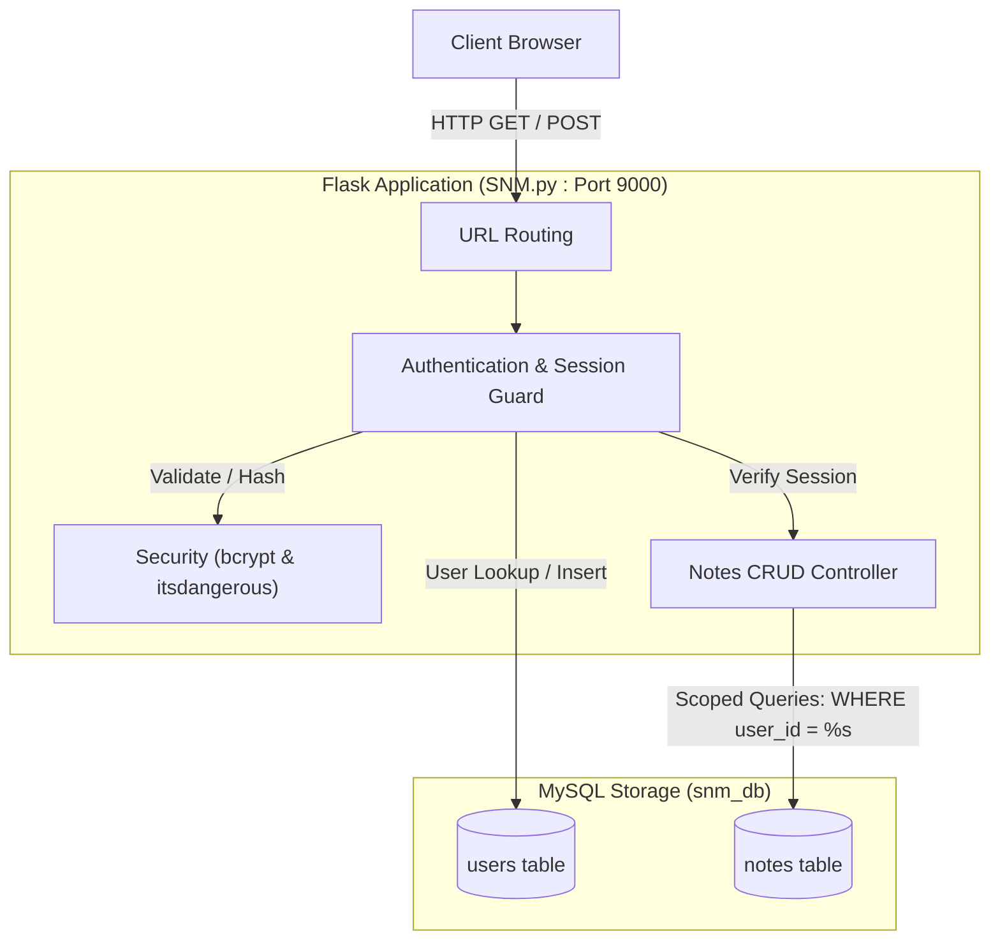
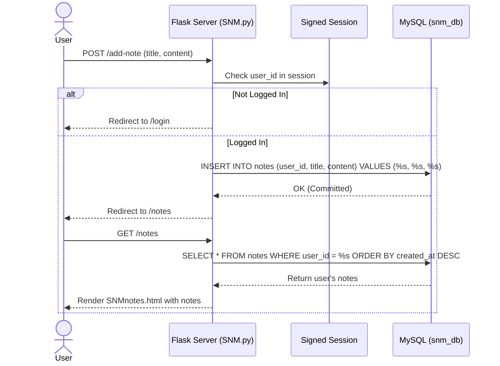

# SNM Notes Management System

[](https://github.com/bhavanajoseph84392-png/SNM-Notes-Mangement-System/blob/main/SNM_Notes_Management_System_Documentation.pdf)
[](https://github.com/bhavanajoseph84392-png/SNM-Notes-Mangement-System/raw/main/SNM_Notes_Management_System_Documentation.pdf)
[](https://www.python.org/)
[](https://flask.palletsprojects.com/)
[](https://www.mysql.com/)

A Python and Flask-based web application backed by MySQL for secure personal note-taking, user registration, authenticated session management, and time-sensitive password resets.

---

## 📖 Project Documentation (Quick Access)

> [!TIP]
> **Complete 15-page Project Documentation is available in this repository.** Anyone can view it online or download it directly using the clickable links below:

| Resource | Format | Direct Clickable Link | Description |
| :--- | :---: | :--- | :--- |
| **Full Project Documentation** | 📄 `PDF` (15 Pages) | [👉 **Click Here to Open Documentation (PDF)**](https://github.com/bhavanajoseph84392-png/SNM-Notes-Mangement-System/blob/main/SNM_Notes_Management_System_Documentation.pdf) | Complete technical report covering system architecture, security workflows, MySQL schema, and viva Q&A. |
| **Direct File Download** | 💾 `PDF` (562 KB) | [📥 **Click Here to Download Documentation**](https://github.com/bhavanajoseph84392-png/SNM-Notes-Mangement-System/raw/main/SNM_Notes_Management_System_Documentation.pdf) | Direct raw download link for offline viewing and printing. |
| **Repository File Link** | 📁 `PDF` | [📄 `./SNM_Notes_Management_System_Documentation.pdf`](./SNM_Notes_Management_System_Documentation.pdf) | Relative link for local clones and repository browser. |
| **Main Application File** | 🐍 `Python` | [🚀 **View SNM.py**](./SNM.py) | Main Flask server containing routes, database access, and cryptographic logic. |
| **Study Notes & Cheatsheet** | 📝 `Text` | [📚 **View notes.txt**](./notes.txt) | Detailed internal developer notes explaining Flask, MySQL, bcrypt, and tokens. |

---

## 📑 Table of Contents
- [📖 Project Documentation (Quick Access)](#-project-documentation-quick-access)
- [1. Project Overview](#1-project-overview)
- [2. Problem Statement](#2-problem-statement)
- [3. Project Objectives](#3-project-objectives)
- [4. Key Features & Actual Behavior](#4-key-features--actual-behavior)
- [5. Technology Stack & Component Justification](#5-technology-stack--component-justification)
- [6. System Architecture & Request Workflow](#6-system-architecture--request-workflow)
- [7. Repository Structure](#7-repository-structure)
- [8. Prerequisites & System Requirements](#8-prerequisites--system-requirements)
- [9. Installation & Setup Instructions for Windows](#9-installation--setup-instructions-for-windows)
- [10. Database Configuration, Schema & Setup](#10-database-configuration-schema--setup)
- [11. Application Startup Commands](#11-application-startup-commands)
- [12. Verified Flask Routes & Endpoints](#12-verified-flask-routes--endpoints)
- [13. Deep Dive into Major Implemented Features](#13-deep-dive-into-major-implemented-features)
- [14. Testing Instructions & Manual Verification Checklist](#14-testing-instructions--manual-verification-checklist)
- [15. Troubleshooting & Common Errors](#15-troubleshooting--common-errors)
- [16. Current Limitations & Recommended Future Enhancements](#16-current-limitations--recommended-future-enhancements)
- [17. Learning Outcomes & Technical Challenges](#17-learning-outcomes--technical-challenges)
- [18. Interview Preparation & Technical FAQ](#18-interview-preparation--technical-faq)

---

## 1. Project Overview

The **SNM Notes Management System** is a lightweight, database-backed note management application. Designed with strict user data isolation, it allows individuals to register an account, securely log in via salted bcrypt hashes, and manage personal notes through a full set of CRUD (Create, Read, Update, Delete) operations. 

Each note is strictly tied to the author's user ID, ensuring that users can only view, edit, and delete their own notes. Additionally, the system implements time-sensitive password recovery using cryptographic URL serialization with expiration timestamps.

---

## 2. Problem Statement

Many standard note-taking tools or entry-level web applications store data either without authentication or fail to enforce proper row-level access control, allowing one user to tamper with another user's records. Furthermore, basic systems often store passwords in plaintext or un-salted formats and lack self-service password recovery mechanisms.

The SNM Notes Management System addresses these challenges by providing:
- Secure credential protection via salted `bcrypt` hashes.
- Row-level data isolation where every SQL query filters strictly by both `note_id` and the authenticated `user_id`.
- Stateless, time-limited password recovery tokens using cryptographic signing (`itsdangerous`).

---

## 3. Project Objectives

- **User Authentication**: Implement user registration with email duplicate checks, salted password hashing, and session-based access control.
- **Strict Data Isolation**: Enforce multi-user data segregation so that no user can access, modify, or delete another user's private notes.
- **Complete Note Lifecycle**: Enable users to create new notes, browse an chronologically ordered list of their notes, view single note details, update contents, and delete notes.
- **Cryptographic Password Recovery**: Provide self-service password resets using timed URL-safe token serialization with a 5-minute validity window.
- **Relational Integrity**: Store structured users and notes data in MySQL with appropriate primary and foreign key constraints.

---

## 4. Key Features & Actual Behavior

### 1. User Registration (`/register`)
- Accepts `name`, `email`, and `password` via form submission.
- Validates that none of the submitted fields are empty.
- Queries MySQL to prevent duplicate email registrations (`SELECT * FROM users WHERE email = %s`).
- Hashes passwords using `bcrypt.hashpw` with automatically generated per-password salt (`bcrypt.gensalt()`).
- Stores user credentials in the `users` table and returns a confirmation message.

### 2. User Authentication & Session Login (`/login`)
- Validates submitted email and password.
- Looks up the user by email in MySQL.
- Verifies the password using `bcrypt.checkpw()`.
- On success, stores `user_id` and `email` inside the Flask client-side `session` object signed with `SNM.secret_key`.
- Redirects authenticated users to `/dashboard`.

### 3. Password Reset Workflow (`/forgot-password` & `/reset-password/<token>`)
- User inputs their registered email address.
- Uses `itsdangerous.URLSafeTimedSerializer` to generate a signed token containing the user's email with the salt `"password-reset"`.
- Generates a full reset link via `url_for("reset_password", token=token, _external=True)`.
- Token validity is enforced with `max_age=300` (5 minutes). If expired, returns `"Reset link has expired"`; if tampered with, returns `"Invalid reset link"`.
- On valid token submission, updates the user's password with a newly hashed `bcrypt` string in MySQL.

### 4. Note Creation (`/add-note`)
- Protected route: redirects unauthenticated users to `/login`.
- Accepts `title` and `content` form fields.
- Associates the note with `session["user_id"]` and inserts the record into MySQL.
- Automatically redirects to the note listing page upon commit.

### 5. Note Listing (`/notes`)
- Fetches all notes belonging to the logged-in user:
  `SELECT note_id, user_id, title, content, created_at, updated_at FROM notes WHERE user_id = %s ORDER BY created_at DESC`.
- Passes the record collection to the frontend template for display.

### 6. Single Note View (`/note/<note_id>`)
- Enforces ownership: `WHERE note_id = %s AND user_id = %s`.
- Returns `"Note not found or unauthorized"` if the note does not exist or belongs to another user.

### 7. Note Updating (`/update-note/<note_id>`)
- Validates ownership before rendering update form.
- On POST, updates `title`, `content`, and sets `updated_at = CURRENT_TIMESTAMP` where `note_id = %s AND user_id = %s`.
- Redirects to the single-note view on success.

### 8. Note Deletion (`/delete-note/<note_id>`)
- Accessible via POST request.
- Deletes record strictly matching both `note_id` and `session["user_id"]`.
- Commits changes to MySQL and redirects back to `/notes`.

### 9. Logout (`/logout`)
- Executes `session.clear()` to erase session state and redirects to `/login`.

---

## 5. Technology Stack & Component Justification

| Technology | Role | Rationale & Code Usage |
| :--- | :--- | :--- |
| **Python (3.10+)** | Core Programming Language | Provides clean syntax, built-in string/byte manipulation, and rich cryptographic libraries. |
| **Flask** | Backend Web Framework | Lightweight WSGI micro-framework managing routing, request lifecycles, and session state. |
| **MySQL Server** | Relational Database | Manages structured tables (`users`, `notes`) with ACID compliance, relational foreign keys, and timestamps. |
| **`mysql-connector-python`** | Database Driver | Executes parameterized SQL queries (`%s`) preventing SQL injection attacks. |
| **`bcrypt`** | Password Security | Industry-standard slow cryptographic hashing with built-in per-password salting to prevent rainbow table attacks. |
| **`itsdangerous`** | Cryptographic Serialization | Employs `URLSafeTimedSerializer` for secure, time-limited (300 seconds), tamper-proof password reset tokens. |
| **Jinja2** | Template Engine | Renders dynamic HTML views (e.g., `SNMnotes.html`, `SNMdashboard.html`). |

---

## 6. System Architecture & Request Workflow



### Request Flow: Note Creation & Viewing


---

## 7. Repository Structure

```text
C:\flask\SNM\
├── .gitignore            # Git exclusion rules
├── AMAZON.py             # Early prototype script (commented-out registration experiment)
├── notes.txt             # Developer notes documenting Flask, MySQL, bcrypt, and tokens
├── README.md             # Complete project guide and technical documentation
├── requirement.txt       # Python dependencies (Flask, mysql-connector-python, bcrypt, itsdangerous)
├── SNM.py                # Main application file containing routes, database, and logic
├── SNM_Notes_Management_System_Documentation.pdf # Complete 15-page project documentation report
└── templates/            # [Recommended] Target folder for Jinja2 template files
    ├── SNMregister.html
    ├── SNMlogin.html
    ├── SNMdashboard.html
    ├── SNMforgotpassword.html
    ├── SNMresetpassword.html
    ├── SNMaddnote.html
    ├── SNMnotes.html
    ├── SNMviewnote.html
    └── SNMupdatenote.html
```

> [!NOTE]
> In the inspected repository state, the HTML templates referenced in `SNM.py` (`SNMregister.html`, etc.) are referenced by `render_template()` calls. If running the application locally without these template files in a `templates/` folder, Flask will raise a `TemplateNotFound` error upon GET requests. The HTML templates can be added to a `templates/` subfolder.

---

## 8. Prerequisites & System Requirements

- **Operating System**: Windows 10 / 11
- **Python**: Version 3.8 or higher (3.10+ recommended)
- **MySQL Server**: MySQL Community Server 8.0+ running locally on port 3306
- **Terminal**: PowerShell or Windows Command Prompt

---

## 9. Installation & Setup Instructions for Windows

### Step 1: Open PowerShell and Navigate to Project Directory
```powershell
cd C:\flask\SNM
```

### Step 2: Configure PowerShell Execution Policy (if required)
```powershell
Set-ExecutionPolicy -ExecutionPolicy RemoteSigned -Scope CurrentUser
```

### Step 3: Create and Activate Virtual Environment
```powershell
python -m venv venv
.\venv\Scripts\Activate.ps1
```

### Step 4: Install Required Packages
Because `requirement.txt` in the repository is currently empty (0 bytes), install the verified dependencies directly:
```powershell
pip install Flask mysql-connector-python bcrypt itsdangerous
```

To persist these dependencies into `requirement.txt`:
```powershell
pip freeze > requirement.txt
```

---

## 10. Database Configuration, Schema & Setup

### Database Configuration in Code
The application connects to MySQL at the top of `SNM.py`:
```python
connection = mysql.connector.connect(
    host="localhost",
    user="root",
    password="root",
    database="snm_db"
)
cursor = connection.cursor()
```

### SQL Initialization Script
Open the MySQL command-line client and execute the following DDL script:

```sql
-- 1. Create Database
CREATE DATABASE IF NOT EXISTS snm_db;
USE snm_db;

-- 2. Create Users Table
CREATE TABLE IF NOT EXISTS users (
    user_id INT AUTO_INCREMENT PRIMARY KEY,
    name VARCHAR(100) NOT NULL,
    email VARCHAR(100) NOT NULL UNIQUE,
    password VARCHAR(255) NOT NULL
);

-- 3. Create Notes Table
CREATE TABLE IF NOT EXISTS notes (
    note_id INT AUTO_INCREMENT PRIMARY KEY,
    user_id INT NOT NULL,
    title VARCHAR(255) NOT NULL,
    content TEXT NOT NULL,
    created_at TIMESTAMP DEFAULT CURRENT_TIMESTAMP,
    updated_at TIMESTAMP DEFAULT CURRENT_TIMESTAMP ON UPDATE CURRENT_TIMESTAMP,
    FOREIGN KEY (user_id) REFERENCES users(user_id) ON DELETE CASCADE
);
```

### Data Flow Overview
1. When a user registers, their record is stored in `users` with an auto-incrementing `user_id`.
2. When creating a note, `session["user_id"]` is passed directly into `INSERT INTO notes (user_id, title, content)`.
3. When querying notes, `WHERE user_id = %s` prevents users from accessing rows created by others.

---

## 11. Application Startup Commands

Ensure MySQL Server is running, then start the application from the project root:

```powershell
python SNM.py
```

### Verified Server Output & Port
As specified in `SNM.py` (`SNM.run(debug=True, port=9000)`), the application runs on **port 9000**:
- **Application URL**: [http://127.0.0.1:9000/](http://127.0.0.1:9000/)
- **Registration**: [http://127.0.0.1:9000/register](http://127.0.0.1:9000/register)
- **Login**: [http://127.0.0.1:9000/login](http://127.0.0.1:9000/login)

---

## 12. Verified Flask Routes & Endpoints

| Route | Methods | Access | Purpose / Behavior |
| :--- | :--- | :--- | :--- |
| `/` | `GET` | Public | Returns welcoming string `"Welcom to Registration System"`. |
| `/register` | `GET`, `POST` | Public | Renders registration form; inserts new user with `bcrypt` hash. |
| `/login` | `GET`, `POST` | Public | Renders login form; validates credentials and sets session. |
| `/dashboard` | `GET` | Authenticated | Renders user dashboard view (`SNMdashboard.html`). |
| `/forgot-password` | `GET`, `POST` | Public | Generates time-sensitive reset token and prints URL to console. |
| `/reset-password/<token>` | `GET`, `POST` | Public | Validates token (300s window); updates password in MySQL. |
| `/add-note` | `GET`, `POST` | Authenticated | Renders creation form; inserts note mapped to `session["user_id"]`. |
| `/notes` | `GET` | Authenticated | Fetches and displays all notes belonging to the current user. |
| `/note/<int:note_id>` | `GET` | Authenticated | Displays a single note; verifies row ownership before rendering. |
| `/update-note/<int:note_id>`| `GET`, `POST` | Authenticated | Updates note title, content, and timestamp for matching user. |
| `/delete-note/<int:note_id>`| `POST` | Authenticated | Deletes note record strictly matching `note_id` and `user_id`. |
| `/logout` | `GET` | Authenticated | Clears `session` dictionary and redirects to `/login`. |

---

## 13. Deep Dive into Major Implemented Features

### 1. Password Hashing with Salt
In `/register` and `/reset-password/<token>`, plaintext passwords are never saved:
```python
hashed_password = bcrypt.hashpw(
    password.encode("utf-8"),
    bcrypt.gensalt()
).decode("utf-8")
```
- `bcrypt.gensalt()` generates a random 128-bit salt and calculates an adaptive key-expansion cost factor.
- In `/login`, `bcrypt.checkpw(password.encode("utf-8"), stored_password)` compares passwords in constant time to thwart timing attacks.

### 2. Timed Token Password Reset
Implemented via `itsdangerous.URLSafeTimedSerializer`:
```python
def generate_reset_token(email): 
    serializer = URLSafeTimedSerializer(SNM.config['SECRET_KEY'])
    return serializer.dumps(email, salt="password-reset")

def verify_reset_token(token):
    serializer = URLSafeTimedSerializer(SNM.config['SECRET_KEY'])
    try:
        return serializer.loads(token, salt="password-reset", max_age=300)
    except SignatureExpired:
        return "expired"
    except BadSignature:
        return "invalid"
```
The token contains the user's email, a timestamp, and an HMAC signature. It expires in 300 seconds (5 minutes) without needing database storage.

### 3. Row-Level Multi-Tenant Segregation
To prevent IDOR (Insecure Direct Object Reference) vulnerabilities, every query targeting an existing note explicitly joins the logged-in `user_id`:
```python
cursor.execute(
    """
    SELECT note_id, user_id, title, content, created_at, updated_at
    FROM notes
    WHERE note_id = %s AND user_id = %s
    """,
    (note_id, user_id)
)
```
If User A tries to view, edit, or delete note ID 5 belonging to User B, the query returns no rows, and the system responds `"Note not found or unauthorized"`.

---

## 14. Testing Instructions & Manual Verification Checklist

- [ ] **Database Setup**: Run the MySQL DDL script; verify `users` and `notes` exist in `snm_db`.
- [ ] **Dependencies**: Verify `pip list` contains `Flask`, `mysql-connector-python`, `bcrypt`, and `itsdangerous`.
- [ ] **Registration**: Submit a POST request to `/register` with `name`, `email`, and `password`. Verify the record is inserted in MySQL with a `$2b$` bcrypt hash.
- [ ] **Duplicate Prevention**: Re-submit `/register` with the same email; confirm response `"Email already exists!"`.
- [ ] **Login**: Submit `/login` with valid credentials; confirm session variables `session["user_id"]` and `session["email"]` are set.
- [ ] **Auth Guard**: Attempt navigating to `/notes` or `/add-note` in an Incognito window; confirm redirect to `/login`.
- [ ] **Create Note**: Submit `/add-note`; verify note appears in MySQL with correct `user_id`.
- [ ] **Update Note**: Submit `/update-note/<id>`; confirm `title`, `content`, and `updated_at` are updated.
- [ ] **Data Isolation (IDOR Check)**: Register User A and User B. Create a note as User A. Log in as User B and attempt to access `/note/<id_of_A>` or POST to `/delete-note/<id_of_A>`; confirm rejection.
- [ ] **Token Expiration**: Request a reset link at `/forgot-password`, wait 6 minutes, and click the link; confirm `"Reset link has expired"`.
- [ ] **Logout**: Visit `/logout`; confirm session is cleared.

---

## 15. Troubleshooting & Common Errors

### 1. `mysql.connector.errors.ProgrammingError: 1045 (28000): Access denied for user 'root'@'localhost'`
- **Cause**: MySQL password in `SNM.py` (`password="root"`) does not match your local MySQL root password.
- **Fix**: Update the connection string credentials in `SNM.py` to match your local database settings.

### 2. `jinja2.exceptions.TemplateNotFound: SNMregister.html`
- **Cause**: The `templates/` folder or the requested HTML file is missing from the directory where `SNM.py` is executed.
- **Fix**: Create a `templates/` directory inside `C:\flask\SNM\` and place the required HTML template files inside.

### 3. `mysql.connector.errors.ProgrammingError: 1146 (42S02): Table 'snm_db.users' doesn't exist`
- **Cause**: Database was created without running the table DDL scripts.
- **Fix**: Execute the DDL table creation commands from Section 10 in your MySQL client.

### 4. `TypeError: a bytes-like object is required, not 'str'` in `bcrypt.checkpw`
- **Cause**: Stored password retrieved from MySQL was returned as a string rather than bytes.
- **Fix**: The code already includes a guard:
  ```python
  if isinstance(stored_password, str):
      stored_password = stored_password.encode("utf-8")
  ```

---

## 16. Current Limitations & Recommended Future Enhancements

| Current Implementation | Known Limitation | Recommended Enhancement |
| :--- | :--- | :--- |
| **Global DB Connection** | Single global `connection` and `cursor` created at application startup. Concurrency or timeout can drop connection. | Use connection pooling (`mysql.connector.pooling`) or request-scoped connections (`get_db_connection()`). |
| **Console Token Output** | Reset link is printed via `print(reset_link)` to terminal rather than emailed. | Integrate Python's `smtplib` or Flask-Mail to dispatch links via email. |
| **Missing Templates in Repo**| HTML templates are not tracked in the main branch. | Commit Jinja2 HTML templates into a `templates/` folder. |
| **Hardcoded Credentials** | Database password (`root`) and `secret_key` hardcoded in `SNM.py`. | Move credentials to a `.env` file using `python-dotenv` and `os.getenv()`. |
| **Search & Filtering** | Note search by keyword or category is not yet implemented. | Add SQL `LIKE` search over title/content and category tags. |

---

## 17. Learning Outcomes & Technical Challenges

- **Cryptographic Security**: Mastered password salting with `bcrypt` and stateless, timed token signing with `itsdangerous`.
- **Relational Access Control**: Handled multi-tenant data segregation at the SQL query level to prevent unauthorized data access.
- **Session Lifecycle**: Implemented protected route guards and cookie-based authentication workflows in Flask.
- **Debugging Type Conversion**: Managed byte/string encodings required by cryptographic libraries and database drivers.

---

## 18. Interview Preparation & Technical FAQ

### 60-Second Elevator Pitch
> *"The SNM Notes Management System is a full-stack Flask web application backed by MySQL for secure personal note-taking. It implements user registration with duplicate email validation, salted bcrypt password hashing, and session-based authentication. The application's core strength is strict row-level data isolation: every CRUD query for notes is scoped by both note ID and the logged-in user ID, preventing unauthorized cross-user access. Additionally, I implemented a time-sensitive password recovery flow using cryptographic URL serialization with itsdangerous, enforcing a strict 5-minute validity window."*

### Technical Walkthrough
1. **Request Ingestion**: Flask receives HTTP requests on port 9000.
2. **Access Control**: Protected endpoints verify `session.get("user_id")` before proceeding.
3. **Database Scoping**: Database queries for notes always enforce `WHERE user_id = %s`, ensuring users only interact with their own records.
4. **Security Layer**: Passwords undergo salted hashing via `bcrypt.hashpw` before database storage; tokens are signed using HMAC-SHA1 via `URLSafeTimedSerializer`.
5. **Session Destruction**: Logging out clears server session keys, preventing session reuse.

---

### 15 Common HR & Technical Interview Questions & Answers

#### Q1: What is the primary purpose of the SNM Notes Management System?
**Answer**: It is a secure multi-user note-taking web application that allows users to register, log in, and manage private notes with complete data isolation so that no user can see or modify another user's notes.

#### Q2: Why did you choose Flask for this project?
**Answer**: Flask is lightweight, flexible, and gives full visibility into routing, session management, and database query handling without unnecessary framework overhead.

#### Q3: How are passwords secured in the database?
**Answer**: Passwords are never stored in plaintext. They are hashed using `bcrypt.hashpw` with an automatically generated salt from `bcrypt.gensalt()`, protecting against rainbow tables and brute-force attacks.

#### Q4: How does the password reset token work without storing it in the database?
**Answer**: It uses `itsdangerous.URLSafeTimedSerializer`. The token embeds the user's email, a timestamp, and an HMAC signature. When submitted, `serializer.loads` verifies the signature and checks that less than 300 seconds have elapsed.

#### Q5: What is IDOR, and how does your project prevent it?
**Answer**: IDOR (Insecure Direct Object Reference) happens when a user modifies a URL parameter (e.g., `/note/5`) to access another user's data. In this project, every query filters by `WHERE note_id = %s AND user_id = %s`, ensuring users can only interact with their own notes.

#### Q6: How does the application maintain user login state?
**Answer**: It uses Flask's client-side `session` mechanism. On successful login, `session["user_id"]` and `session["email"]` are stored in a cryptographically signed cookie.

#### Q7: How are SQL injection attacks prevented?
**Answer**: All SQL statements use parameterized queries with `%s` placeholders. Values are passed as tuples to `cursor.execute()`, preventing user input from altering query structure.

#### Q8: What database engine is used, and what tables exist?
**Answer**: MySQL is used with two main tables: `users` (storing `user_id`, `name`, `email`, `password`) and `notes` (storing `note_id`, `user_id`, `title`, `content`, `created_at`, `updated_at`).

#### Q9: What happens if an expired reset token is used?
**Answer**: The `verify_reset_token` function catches `SignatureExpired` from `itsdangerous` and returns `"expired"`, prompting the message `"Reset link has expired"`.

#### Q10: Why is `connection.commit()` required after SQL INSERT, UPDATE, and DELETE queries?
**Answer**: In relational databases, write operations run inside transactions. Calling `connection.commit()` persists the transaction permanently to disk; without it, changes would be rolled back when the connection closes.

#### Q11: What is the purpose of `notes.txt` in the repository?
**Answer**: It serves as internal technical study notes detailing how `render_template`, `mysql.connector`, `cursor`, `bcrypt`, sessions, and token serialization work in Flask.

#### Q12: What is `AMAZON.py` in the repository?
**Answer**: It is an early prototype script containing commented-out experimental code for a registration form with confirm password and mobile fields, predating the current `SNM.py` implementation.

#### Q13: What happens if a user submits empty fields during registration or note creation?
**Answer**: The backend performs input validation (e.g., `if not title or not content: return "Title and content are required"`), returning an informative error message.

#### Q14: What is the architectural difference between client-side and server-side sessions?
**Answer**: Client-side sessions store data in encrypted/signed cookies on the user's browser, while server-side sessions store data in a database or cache (e.g., Redis) and send only a session ID to the browser. Flask default sessions are client-side signed cookies.

#### Q15: If you were to refactor this application for production, what would be your top priorities?
**Answer**:
1. Move database credentials and secret keys to environment variables using `.env`.
2. Replace the single global database connection with a connection pool.
3. Integrate an SMTP email service to send password reset links instead of printing them to the console.
4. Structure the code using Flask Blueprints for modularity.
